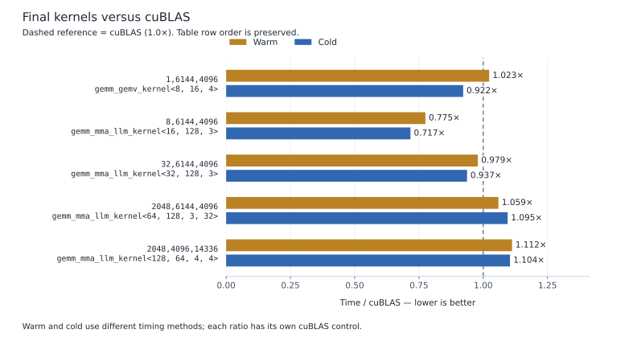
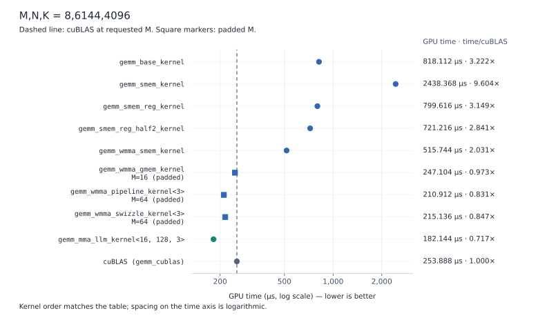
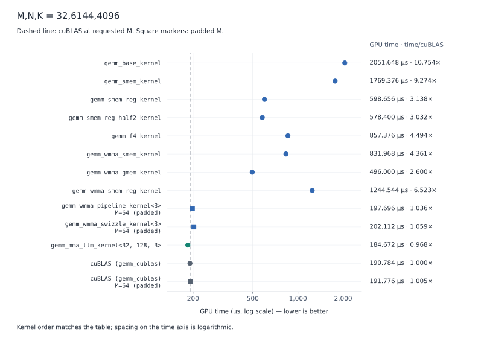
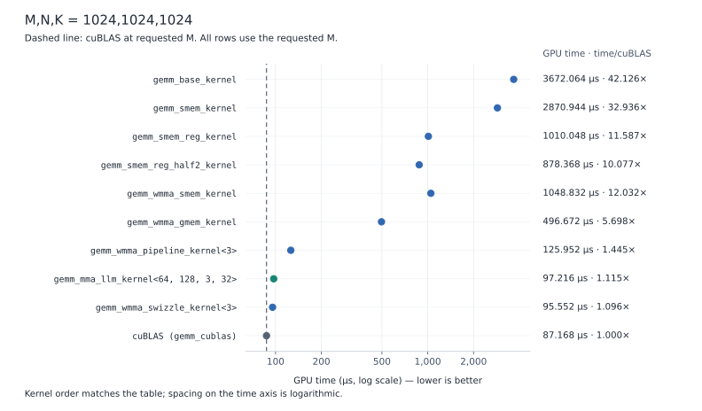

# Performance

## 1. Test methods

All matrices are contiguous row-major FP16, with FP32 accumulation, alpha=1 and beta=0. Times are GPU microseconds per complete GEMM. **Time/cuBLAS** means kernel time divided by cuBLAS time for the same measurement method; a value below 1 favors the named kernel.

Build and pass the correctness tests before collecting timings:

```bash
./scripts/build.sh
./scripts/test.sh
./scripts/benchmark.sh --suite current
./scripts/benchmark_square.sh
```

### Warm-input tests

Reuse A and B without explicit cache eviction. Submit 20 warmup calls per implementation and wait for completion. Collect 11 trials, alternating the named kernel and cuBLAS. CUDA events bracket one ordinary default-stream GEMM per sample; report the median. Allocation, input initialization and C reset finish before timing. Reused inputs do not imply that an entire matrix fits in cache.

### Cold-input tests

Submit ten warmup GEMMs per implementation and wait for completion. Before each sample, restore C and read a separate 256 MiB pseudorandom eviction buffer using `ld.global.ca`. Wait for that sweep to finish, then capture one complete GEMM inside the `gemm-profile` NVTX range.

```cpp
// Initialize C before warmup.
d.reset(v);

// 1. Submit ten complete GEMM calls.
for (int w = 0; w < 10; ++w)
    launch(d.s, v, d.a, d.b, d.c);

// 2. Finish warmup.
CK(cudaDeviceSynchronize());

// 3. Restore C so warmup does not change the profiled input.
d.reset(v);

// 4. Evict cached operands; this helper waits for its sweep to finish.
d.cold();

// 5. Capture one complete GEMM, including any internal reduction kernels.
nvtxRangePushA("gemm-profile");
launch(d.s, v, d.a, d.b, d.c);
CK(cudaDeviceSynchronize());
nvtxRangePop();
```

## 2. Final implementation versus cuBLAS

Each row identifies the specialization selected by `gemm_launcher` for that shape. All five shapes execute at their requested M without padding. Warm values are medians of 11 ordinary-launch trials; cold values are medians of nine complete-call profiler trials.

| M,N,K | Selected kernel | Warm µs | Warm cuBLAS µs | Warm time/cuBLAS | Cold µs | Cold cuBLAS µs | Cold time/cuBLAS |
|---|---|---:|---:|---:|---:|---:|---:|
| 1,6144,4096 | `gemm_gemv_kernel<8, 16, 4>` | 192.832 | 188.544 | 1.023 | 189.312 | 205.408 | 0.922 |
| 8,6144,4096 | `gemm_mma_llm_kernel<16, 128, 3>` | 193.792 | 250.016 | 0.775 | 182.144 | 253.888 | 0.717 |
| 32,6144,4096 | `gemm_mma_llm_kernel<32, 128, 3>` | 190.912 | 195.008 | 0.979 | 185.792 | 198.368 | 0.937 |
| 2048,6144,4096 | `gemm_mma_llm_kernel<64, 128, 3, 32>` | 2892.544 | 2731.104 | 1.059 | 3406.112 | 3109.952 | 1.095 |
| 2048,4096,14336 | `gemm_mma_llm_kernel<128, 64, 4, 4>` | 7348.096 | 6608.704 | 1.112 | 7808.032 | 7072.896 | 1.104 |



Note:
mma_llm<16, 128, 3> is ~28% faster than cublas for the following reasons:
  1. efficient memory load. direct cp.async from gmem to smem, where cublas use intermediate regsters.
  2. cublas use split k and merging, this has additonal merge kernel cost, but this is small 9us/253us
  3. cublas's launch has less warp shared tile. it use 1 warp/block to compute A(16 * 64) matmul B (64 * 16), where mma_llm use 4 warps/block to compute A(16*32) matmul B(16*64)
     l1tex__t_sectors_pipe_lsu_mem_global_op_ld.sum shows 25% less traffic, comes from A load 24MB (cublas) -> 6MB (mma_llm)
the speedup comes from no split k (9us) and more efficient memory staging (4 warps per block, direct gmem to smem copy, skipping reg intermediate)

## 3. Progressive kernel comparisons

**Executed M** is the physical number of rows passed to the implementation. Padded rows perform extra work and are diagnostic controls, not equal-work speedup claims. Time/cuBLAS uses the cuBLAS control at the requested M; the M=32 table also retains a cuBLAS M=64 padding control. Grid and block dimensions are (x,y), with z=1.

### M,N,K = 8,6144,4096

| Kernel | Executed M | Grid (x,y) | Block (x,y) | GPU µs | Time/cuBLAS |
|---|---:|---|---|---:|---:|
| `gemm_base_kernel` | 8 | (192,1) | (32,8) | 818.112 | 3.222 |
| `gemm_smem_kernel` | 8 | (192,1) | (32,32) | 2438.368 | 9.604 |
| `gemm_smem_reg_kernel` | 8 | (192,1) | (16,16) | 799.616 | 3.149 |
| `gemm_smem_reg_half2_kernel` | 8 | (192,1) | (16,16) | 721.216 | 2.841 |
| `gemm_wmma_smem_kernel` | 8 | (384,1) | (32,1) | 515.744 | 2.031 |
| `gemm_wmma_gmem_kernel` | 16 (padded) | (384,1) | (32,1) | 247.104 | 0.973 |
| `gemm_wmma_pipeline_kernel<3>` | 64 (padded) | (96,1) | (128,1) | 210.912 | 0.831 |
| `gemm_wmma_swizzle_kernel<3>` | 64 (padded) | (96,1) | (128,1) | 215.136 | 0.847 |
| `gemm_mma_llm_kernel<16, 128, 3>` | 8 | (48,1) | (128,1) | 182.144 | 0.717 |
| cuBLAS (`gemm_cublas`) | 8 | library | library | 253.888 | 1.000 |



`gemm_smem_kernel` is slower than base because it uses a 32-row tile while there are only eight real output rows, so 24 tile rows do not contribute stored outputs.

### M,N,K = 32,6144,4096

| Kernel | Executed M | Grid (x,y) | Block (x,y) | GPU µs | Time/cuBLAS |
|---|---:|---|---|---:|---:|
| `gemm_base_kernel` | 32 | (192,4) | (32,8) | 2051.648 | 10.754 |
| `gemm_smem_kernel` | 32 | (192,1) | (32,32) | 1769.376 | 9.274 |
| `gemm_smem_reg_kernel` | 32 | (192,1) | (16,16) | 598.656 | 3.138 |
| `gemm_smem_reg_half2_kernel` | 32 | (192,1) | (16,16) | 578.400 | 3.032 |
| `gemm_f4_kernel` | 32 | (192,1) | (4,32) | 857.376 | 4.494 |
| `gemm_wmma_smem_kernel` | 32 | (384,2) | (32,1) | 831.968 | 4.361 |
| `gemm_wmma_gmem_kernel` | 32 | (384,2) | (32,1) | 496.000 | 2.600 |
| `gemm_wmma_smem_reg_kernel` | 32 | (192,1) | (32,1) | 1244.544 | 6.523 |
| `gemm_wmma_pipeline_kernel<3>` | 64 (padded) | (96,1) | (128,1) | 197.696 | 1.036 |
| `gemm_wmma_swizzle_kernel<3>` | 64 (padded) | (96,1) | (128,1) | 202.112 | 1.059 |
| `gemm_mma_llm_kernel<32, 128, 3>` | 32 | (48,1) | (128,1) | 184.672 | 0.968 |
| cuBLAS (`gemm_cublas`) | 32 | library | library | 190.784 | 1.000 |
| cuBLAS (`gemm_cublas`) | 64 (padded) | library | library | 191.776 | 1.005 |



### M,N,K = 1024,1024,1024

| Kernel | Executed M | Grid (x,y) | Block (x,y) | GPU µs | Time/cuBLAS |
|---|---:|---|---|---:|---:|
| `gemm_base_kernel` | 1024 | (32,128) | (32,8) | 3672.064 | 42.126 |
| `gemm_smem_kernel` | 1024 | (32,32) | (32,32) | 2870.944 | 32.936 |
| `gemm_smem_reg_kernel` | 1024 | (32,32) | (16,16) | 1010.048 | 11.587 |
| `gemm_smem_reg_half2_kernel` | 1024 | (32,32) | (16,16) | 878.368 | 10.077 |
| `gemm_wmma_smem_kernel` | 1024 | (64,64) | (32,1) | 1048.832 | 12.032 |
| `gemm_wmma_gmem_kernel` | 1024 | (64,64) | (32,1) | 496.672 | 5.698 |
| `gemm_wmma_pipeline_kernel<3>` | 1024 | (16,16) | (128,1) | 125.952 | 1.445 |
| `gemm_mma_llm_kernel<64, 128, 3, 32>` | 1024 | (128,1) | (128,1) | 97.216 | 1.115 |
| `gemm_wmma_swizzle_kernel<3>` | 1024 | (16,16) | (128,1) | 95.552 | 1.096 |
| cuBLAS (`gemm_cublas`) | 1024 | library | library | 87.168 | 1.000 |



## 4. TensorRT-LLM inference

### Setup and method

The recorded experiment uses `meta-llama/Llama-3.2-1B-Instruct` in FP16 on an RTX PRO 1000 Blackwell Laptop GPU (SM120). TP=1 and PP=1; FlashInfer attention, paged KV cache, chunked prefill, overlap scheduling and decode CUDA graphs are enabled. Graph buckets are 1/2/4/8/16 with padding. Both variants retain the same 24,576-token FP16 KV capacity. Quantization, prefix reuse and speculative decoding are disabled.

The official `trtllm-bench` measures runtime inference. `trtllm-serve` and its release-matched benchmark client measure streaming HTTP over loopback. Each ordinary run excludes 32 warmup requests and measures 200 completed requests. Compilation, weight packing, autotuning and graph capture precede measurement; profiler captures are separate from timing runs.

The completed experiment includes 128/512 input/output tokens at concurrency 1/2/4/8/16; 1024/256, 1024/1 and an equal short/long mix at concurrency 8; QKV-only ablations; synchronized eight-sequence controls; and mixed open-loop serving at 50/80/100/120% of stock calibration throughput. The campaign contains 232 runs, including two superseded mixed-serving runs; 230 runs form the selected analysis set.

### Primary decode results

128 input tokens, 512 output tokens, concurrency eight. **Custom** means all eligible dense projections using `gemm_mma_llm_kernel<16, 128, 3>` for physical M=8. The single-row path uses `gemm_gemv_kernel`. Stock M8 projections in the diagnostic traces use `cutlass_80_wmma_tensorop_f16_s161616gemm_f16_16x16_128x1_tn_align8`.

| Interface | Metric | Stock | Custom | Change | Paired 95% CI |
|---|---|---:|---:|---:|---|
| Runtime | Output tokens/s | 816.318 | 813.881 | -0.30% | [-0.86%, +0.25%] |
| Runtime | TPOT, ms | 9.629 | 9.656 | +0.27% | [-0.28%, +0.83%] |
| HTTP serving | Output tokens/s | 785.568 | 772.967 | -1.61% | [-2.28%, -0.75%] |
| HTTP serving | TPOT, ms | 9.998 | 10.164 | +1.66% | [+0.83%, +2.35%] |


**Conclusion:** runtime inference is effectively unchanged;.

### Replacement coverage and interpretation

In the stock trace, targeted GEMMs occupy **38.67% of the selected elapsed window** and **92.62% of GPU-kernel execution time**.
The replacement GEMM is observed to replace **98.1~99.6% of target GEMM kernel calls** and **82.1~98.6% of GEMM kernel time**.

### Integration example

The [sample code](../samples/trtllm_gemm/) shows how the measured integration works: load a CUDA operator in each model worker, pack weights once from `W[N,K]` into contiguous `B[K,N]`, intercept eligible unquantized linear calls, and launch the existing GEMV/MMA kernels on PyTorch's current CUDA stream. Unsupported inputs call the original TRT-LLM method. The standalone launcher and kernel sources are unchanged.

`adapter.py` shows packing and method interception; `binding.cpp` connects tensors to CUDA; `launcher.cu` supplies an explicit stream to the existing kernels; `__init__.py` loads the sample through `--custom_module_dirs`. The sample expects a prebuilt extension specified by `GEMM_SAMPLE_LIBRARY`. Select `stock` (default), `qkv_only` or `all_dense` with `GEMM_SAMPLE_MODE`.
